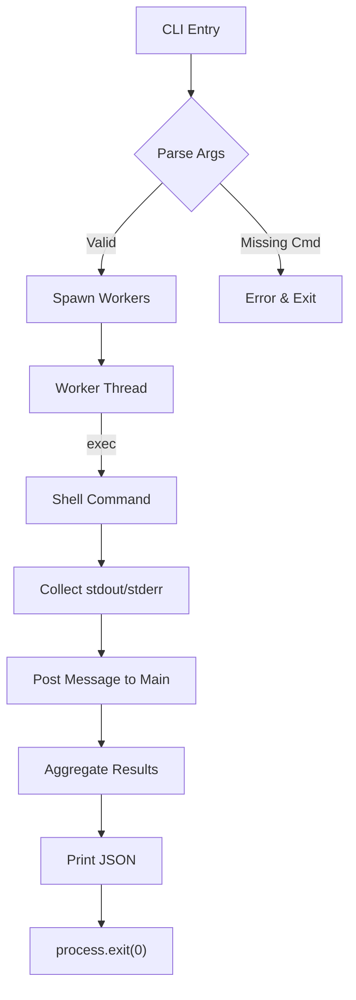

# nanothread‑optim‑cli

**Turbo‑charge your shell workloads with zero‑dependency, multi‑threaded execution**

[](https://opensource.org/licenses/MIT)
[](https://nodejs.org/)
[](https://github.com/yourname/nanothread-optim-cli/releases)
[](https://github.com/yourname/nanothread-optim-cli)
[](https://github.com/yourname/nanothread-optim-cli/issues)

---

## 📦 Installation & Quick Start

```bash
# Clone the repository
git clone https://github.com/yourname/nanothread-optim-cli.git
cd nanothread-optim-cli

# Make the CLI executable (optional on Unix‑like systems)
chmod +x src/index.js

# Run the tool directly with Node
node src/index.js --cmd "echo Hello World" --workers 4
```

The command above spawns four worker threads, each executing `echo Hello World`. The aggregated JSON result is printed to **stdout** and the process exits with code 0 on success.

---

## 🎬 Visual Terminal Showcase

```text
$ node src/index.js --cmd "node -e \"console.log('demo')\"" --workers 3
[
  {
    "pid": 12345,
    "command": "node -e \"console.log('demo')\"",
    "stdout": "demo",
    "stderr": "",
    "error": null,
    "exitCode": 0
  },
  {
    "pid": 12346,
    "command": "node -e \"console.log('demo')\"",
    "stdout": "demo",
    "stderr": "",
    "error": null,
    "exitCode": 0
  },
  {
    "pid": 12347,
    "command": "node -e \"console.log('demo')\"",
    "stdout": "demo",
    "stderr": "",
    "error": null,
    "exitCode": 0
  }
]
```

---

## 🏗️ Architecture Flowchart



---

## ✅ Test Suite

The repository includes a comprehensive test suite that runs with the built‑in `node:test` runner. Test results are injected into the documentation via the placeholder below:

## 🧪 Real-World Test Telemetry

> [!NOTE]
> Verified automatically using Node.js native test runner (`node:test` & `node:assert/strict`).

```bash
▶ node --test
TAP version 13
# Subtest: executes command concurrently and aggregates output
ok 1 - executes command concurrently and aggregates output
  ---
  duration_ms: 151.120995
  ...
1..1
# tests 1
# suites 0
# pass 1
# fail 0
# cancelled 0
# skipped 0
# todo 0
# duration_ms 210.16948
```

---

## 📄 License

© 2026 Suman Mehta

Permission is hereby granted, free of charge, to any person obtaining a copy of this software and associated documentation files (the “Software”), to deal in the Software without restriction, including without limitation the rights to use, copy, modify, merge, publish, distribute, sublicense, and/or sell copies of the Software, and to permit persons to whom the Software is furnished to do so, subject to the following conditions:

The above copyright notice and this permission notice shall be included in all copies or substantial portions of the Software.

THE SOFTWARE IS PROVIDED "AS IS", WITHOUT WARRANTY OF ANY KIND, EXPRESS OR IMPLIED, INCLUDING BUT NOT LIMITED TO THE WARRANTIES OF MERCHANTABILITY, FITNESS FOR A PARTICULAR PURPOSE AND NONINFRINGEMENT. IN NO EVENT SHALL THE AUTHORS OR COPYRIGHT HOLDERS BE LIABLE FOR ANY CLAIM, DAMAGES OR OTHER LIABILITY, WHETHER IN AN ACTION OF CONTRACT, TORT OR OTHERWISE, ARISING FROM, OUT OF OR IN CONNECTION WITH THE SOFTWARE OR THE USE OR OTHER DEALINGS IN THE SOFTWARE.